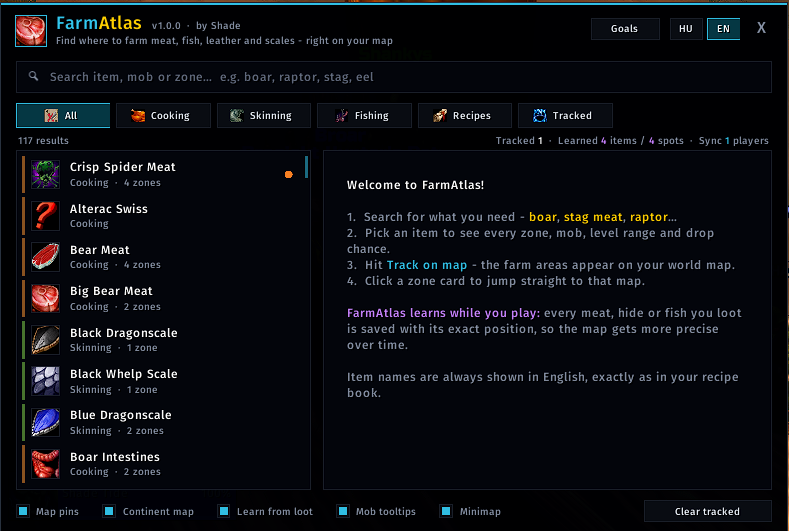

# FarmAtlas



**Find where to farm every cooking meat, leather, scale and fish - right on your world map and minimap.** Made for **WoW Forever**.

Download: [CurseForge](https://www.curseforge.com/wow/addons/farmatlas)


**Find where to farm any cooking meat, leather, scale or fish - right on your world map.**

Search "boar", "raptor", "thick leather" or "eel", hit **Track on map**, and the farm areas light up on your world map with the item's icon, mob names and level ranges.

## Features

- **Search everything**: item names, mob names, zone names and keywords (e.g. `boar`, `pork`, `wolf`, `rugged`, `squid`).
- **105 farmable materials** built in (~250 farm areas):
  - Cooking (53): every mob-dropped cooking ingredient in WoW Forever. That covers boar, wolf, bear, lion, tiger, stag, raptor, croc, turtle, bat, bird, egg, spider, kodo, crab, clam, murloc and more, plus the new Forever smoothie reagents (Spider Ichor, Small Venom Sac, Large Fang, Small Flame Sac, Wicked Claw)
  - Each spot lists the mob names, level range and **drop chance**
  - Skinning (28): Light to Rugged Leather and Hides, Devilsaur, Warbear, Chimera, Frostsaber, scorpid, turtle, whelp and dragon scales
  - Fishing (24): every fish used in cooking, including the new Forever fish
- **Farm goals window**: set how many you need (for example 20x Raptor Flesh). A progress bar counts your bags and bank, and you get a raid-warning message and a sound when you reach the goal. Ctrl-click a result to add it quickly.
- **Bags, bank and alts**: every character's bags and bank are remembered. The atlas, the goals window and item tooltips show what you have and what your alts have.
- **Recipes**: for any ingredient, see every recipe that uses it, whether you or your alts know it, and where to learn it (trainer, vendor with location and price, quest or drop). Click a recipe to put a marker on the map.
- **Self-learning**: FarmAtlas learns from your Cooking window (known recipes and exact reagents), from trainers, from every vendor that sells recipes, and from recipe drops.
- **English / Hungarian interface** (EN | HU buttons, or `/farm lang hu`). Item, recipe, mob and zone names always stay in English, exactly as they appear in the in-game recipe book.
- **World map overlay**: colored farm areas plus clickable item icons. You can track several items at once, and each gets its own color. Pins also show on the continent map.
- **Recommended spot** for your level, with dangerous zones flagged.
- **Learns while you play**: every meat, hide or fish you loot is saved with its exact position and source mob. The map gets more precise over time, and items that aren't in the database are added automatically.
- **Real drop rates**: FarmAtlas counts the mobs you kill and loot, and shows the real WoW Forever drop rate per mob (e.g. `Mottled Boar (3): 42% (21/50)`) once there are at least 5 kills.
- **Automatic sharing (no buttons)**: discoveries are shared in the background with party, raid and guild members who also run FarmAtlas, through Blizzard's hidden addon message channel (like GatherMate2). Only absolute counts are sent, so nothing is ever counted twice. `/farm sync` and `/farm guildsync` switch it off.
- **Community data**: every release ships `Data\Community.lua`, merged from players' SavedVariables with `tools/merge_community.py`.
- **Mob tooltips**: hovering a mob shows what farmable materials it drops.
- Map button, minimap button, slash commands.

## Usage

| Command | What it does |
|---|---|
| `/farm` | Open FarmAtlas |
| `/farm boar` | Open and search for "boar" |
| `/farm clear` | Stop tracking everything |
| `/farm pins` | Toggle world map pins |
| `/farm learn` | Toggle learning from loot |
| `/farm minimap` | Toggle the minimap button |
| `/farm lang en` / `/farm lang hu` | Interface language |
| `/farm goals` | Show or hide the farm goals window |

- **Click** a result to see its details. **Right-click** a result to track or untrack it.
- **Click** a zone card to open that map with the item tracked.
- On the world map, **click** an icon to open it in FarmAtlas. **Right-click** an icon to untrack it.

## Installation

Copy the `FarmAtlas` folder into `World of Warcraft\_<flavor>_\Interface\AddOns\`.
If the game says the addon is out of date, enable **Load out of date AddOns** on the character select AddOns screen.

## Notes

- Mob names, levels and drop chances come from the WoW Forever item database (Classic-based drop data). Map circles mark approximate areas. WoW Forever changes some zones, so the addon's own loot learning fills in the real data.
- Zone IDs are checked by name at runtime, so renamed or re-numbered maps still resolve when possible.
- Herbs, ore and fishing pools as nodes are left to GatherMate2. FarmAtlas focuses on what GatherMate doesn't cover.

## Contributing data

Send your `WTF\Account\<ACCOUNT>\SavedVariables\FarmAtlas.lua` file (it already contains everything your party and guild shared with you). The maintainer merges the files:

```
python3 tools/merge_community.py FarmAtlas_*.lua -o Data/Community.lua
```

## Author

Created by **Shade**.

## License

MIT - Copyright (c) 2026 Shade
