# FarmAtlas

**Find where to farm every cooking meat, leather, scale, fish, ore and herb - right on your world map and minimap.**

Made for **WoW Forever**. Search *boar*, *raptor*, *stag* or *Giant Egg* and FarmAtlas shows you the best farm areas with mob names, levels and drop chances, marks them on your map, tells you which recipes use the ingredient, and counts what you already have in your bags, bank and on your alts.

FarmAtlas is your farming and profession companion: where to farm it, what it is worth, what you can make from it and how to level your profession. For exact herb and ore nodes it works together with **Questie**, **GatherMate2** and **Gatherer** - no duplicate maps.

---

## New in 1.3.1

- **Tailoring, First Aid and Alchemy 1-300 guides (Tailoring new in 1.3.2):** every trainer at its exact position - and only the trainers who really teach your next rank. Recipe and manual vendors, the Expert First Aid book and the Triage quest are on the map too. Routes cross-checked on several guide sites.

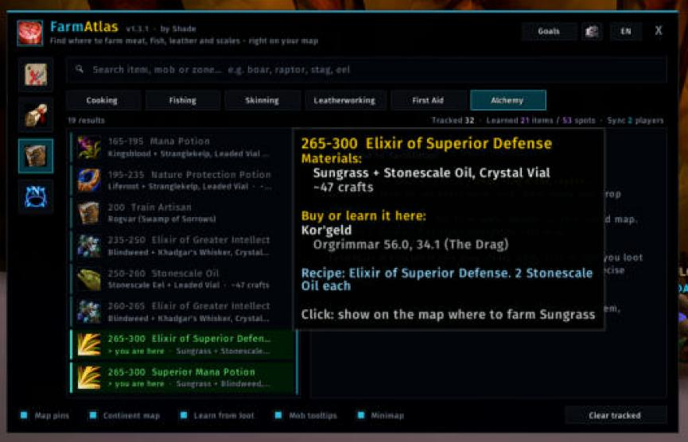

- **Fishing schools:** FarmAtlas remembers where you fished from a school (any fish) and can warn you when you come near a school spot of a fish you track.
- **Community finds** ship with the addon and are added to your own data in game - never replacing it.
- Book and quest steps (Expert / Artisan Cooking and Fishing, e.g. Nat Pagle) are no longer shown as trainers.

## New in 1.3.0

- **Fixed: learning works with auto loot.** Before, gathered and looted items were often not recorded. Your finds are learned and shared with your guild again.
- **Mining and Herbalism:** every ore and herb with its zones and the skill it needs.

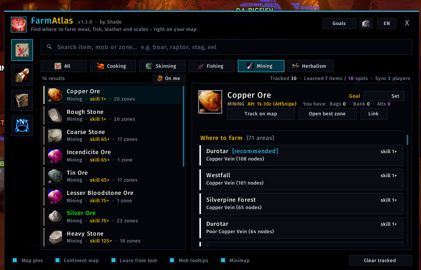

- **Exact herb and ore nodes:** with Questie, GatherMate2 or Gatherer installed, every known vein and herb is shown at its exact place on the map and minimap. The positions are read on your own computer - nothing is copied into FarmAtlas or sent to anyone.

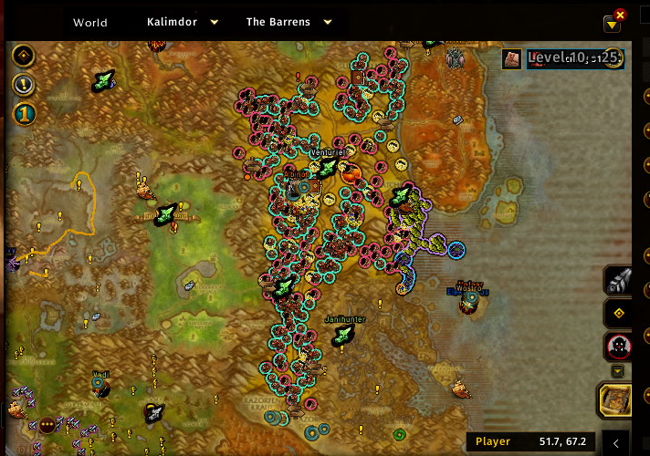

- **Fishing places on the water:** one marker per lake, river or coast - never a circle over dry land. Hover it to see every fish you can catch there and the skill you need.

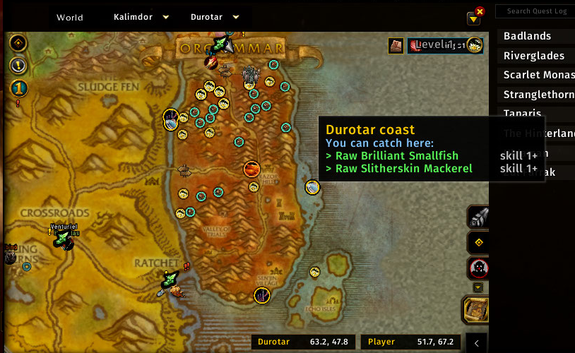

- **Leatherworking 1-300 guide** with every trainer and pattern vendor at their exact position.

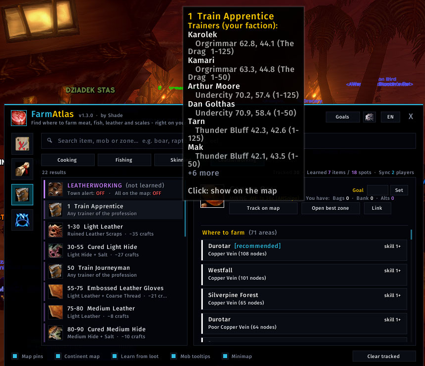

- **Gathered spots as small icons** on the map and minimap, with two new settings: icon size, and hide the icon when you are close so you can see the herb or ore under it.

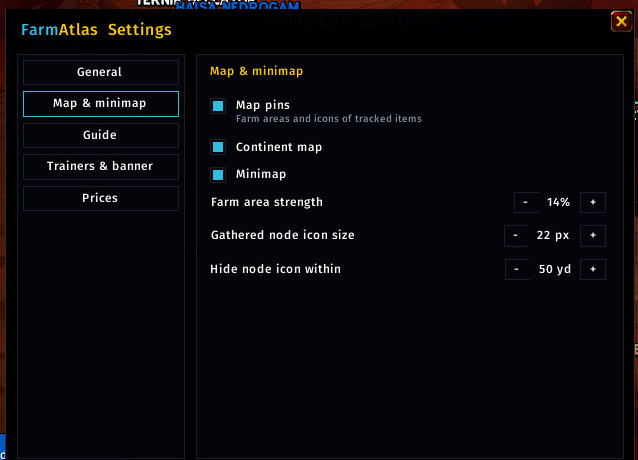

- **New layout:** a menu on the left side of the window - Atlas, Recipes, Guides, Tracked.

## New in 1.2.1 - Giga Database Update

- **Every farm spot:** each meat, leather, scale and fish lists all the zones where it can be farmed - **746 new farm areas in 410 more zones**, with mobs, levels and drop chances.
- 3 new fish: Raw Slitherskin Mackerel, Raw Sagefish, Raw Greater Sagefish.
- The minimap button stays visible next to button collectors and minimap skins; FarmAtlas is also in the game's addon menu.

## New in 1.2.0

- **Leveling guides**: Cooking, Fishing and Skinning 1-300 for WoW Forever, faction-aware, with your current step highlighted and the places marked on the map.
- **Trainers** of your current step on the map and minimap, exact WoW Forever coordinates, plus a **town banner** when you arrive somewhere with a trainer you care about.
- **Farm / hour in gold** and auction house prices (Auctionator / TSM / AHSnipe, vendor price as fallback) on tooltips.
- **Click a recipe** to open your profession window on it, or see where to learn it.
- **French, German and Spanish** interface.

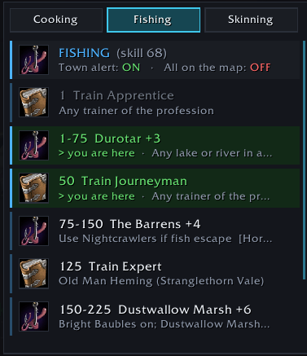

---

## Features

**Farm atlas**
- 150+ farmable materials built in: cooking meats & ingredients, leather, hides & scales, fish, ores and herbs.
- Every material lists its farm areas with mob names, level range and drop chance.
- A **recommended** zone for your level, and dangerous zones are flagged.
- Search by item, mob, zone or keyword (`boar`, `wolf`, `rugged`, `squid`...).
- Materials are listed in **leveling order**, with the level or fishing skill on every row.
- **On me** filter: only what is in your bags.

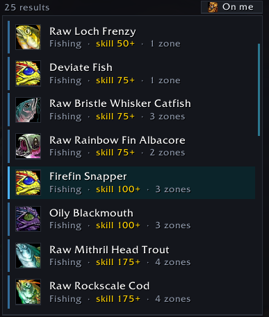

**Map & minimap**
- Translucent, quest-style farm areas with a dashed outline on the world map.
- Track several items at once, each in its own color.
- **Minimap**: the area when it is close, an edge icon pointing the way when it is far, and a colored glow when you are standing inside it.
- **Fishing places** sit on the water itself, one per lake / river / coast, with what you can catch there.
- **Herbs and ore** at their exact nodes when Questie, GatherMate2 or Gatherer is installed.
- Small icons where you (or your guild) actually gathered; adjustable size, auto-hide when you are close.

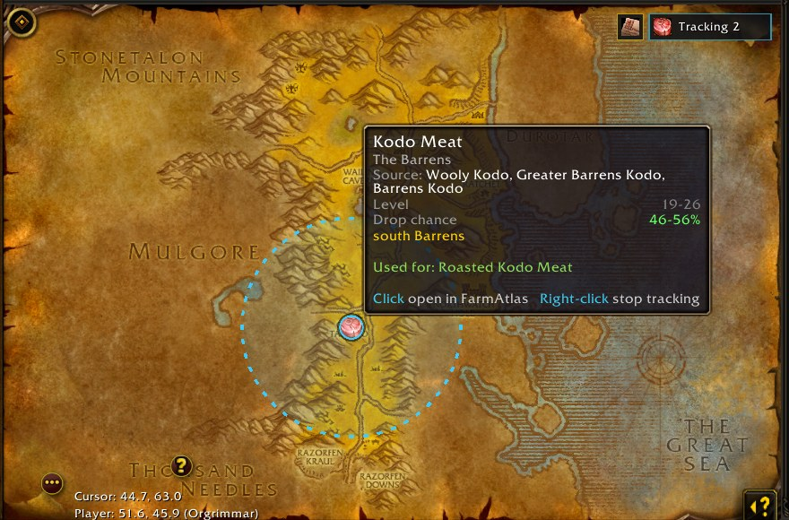

**Leveling guides**
- **Cooking, Fishing, Skinning, Leatherworking, Tailoring, First Aid and Alchemy 1-300**, each on its own tab: what to make, where to go, which rank to train next.
- Click a step: the place is marked in gold on the world map; cooking steps show where to farm the material.
- The trainers of your current step appear on the map and minimap automatically.
- **Town alert**: a movable, resizable banner when you arrive at a town, village or camp with a trainer of a profession you switched on.

**Recipes**
- **Recipes tab**: all 123 WoW Forever cooking recipes. The ones you don't know have a red veil, but the whole recipe is readable on hover - the game's own item tooltip with the exact effect, skill colors and reagents.
- **Click** a known recipe to open your profession window on it; click an unknown one to see where to buy or learn it, with the place on the map.
- **Craftable now** filter: only the recipes you have every ingredient for.
- Reads your Cooking window automatically - no buttons.

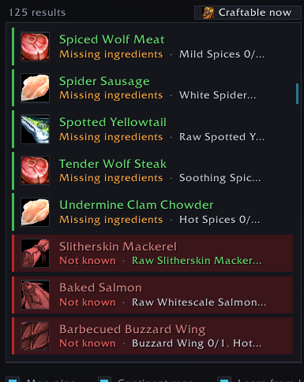

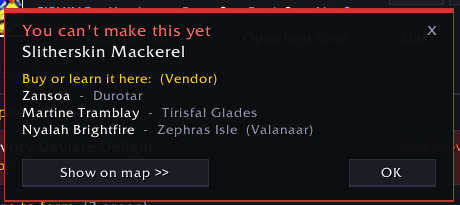

**Goals**
- Set how many you need (e.g. 20x Raptor Flesh). A progress bar counts your bags and bank, and you get an on-screen message and a sound when the goal is reached.

**Bags, bank & alts**
- Item tooltips and the atlas show how many you have on this character, in the bank and on your alts.

**Prices & farm / hour**
- Auction house price on item and mob tooltips from Auctionator, TSM or AHSnipe (all optional); the last known price, or the vendor price, when none is open.
- **Farm / hour in gold**: what you really looted in the last 60 minutes and what it is worth, plus the value of everything you own.

**Settings**
- Gear button in the atlas (or `/farm config`): every switch, grouped by topic. A short "What's new" window after each update.

**Learns while you play**
- Every meat, hide, fish, ore or herb you loot or gather is saved with its exact spot and source (auto loot included).
- **Real WoW Forever drop rates** from your own kills (e.g. `Mottled Boar: 42% (21/50)`).

**Automatic sharing (no buttons)**
- Discoveries are shared in the background with your **party, raid and guild** members who also use FarmAtlas, through Blizzard's hidden addon channel (like GatherMate2). Turn it off with `/farm sync`.

**Quick search**
- **Alt + click** any item (bags, chat link, recipe reagent) to open it in FarmAtlas.

**Languages**
- English, Hungarian, French, German and Spanish interface. On a French, German or Spanish game client FarmAtlas starts in that language, and item, recipe and zone names are shown the way your game names them (English names work in the search too).

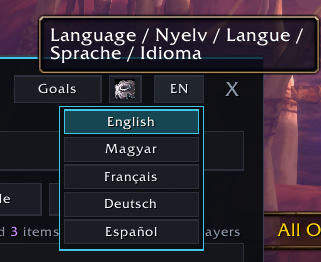

---

## Commands

| Command | |
| --- | --- |
| `/farm` | open FarmAtlas (also: minimap button, world map button) |
| `/farm boar` | open with a search |
| `/farm goals` | farm goals window |
| `/farm config` | settings |
| `/farm trainers` | every trainer of a profession on the map |
| `/farm banner` | move / resize the town banner |
| `/farm news` | what's new |
| `/farm sync` | background sharing on/off |
| `/farm lang en` / `hu` / `fr` / `de` / `es` | interface language |
| `/farm help` | all commands |

---

## Help the community map

Drop chances and areas start from Classic-based data and get more precise with every player. Your `WTF\Account\<ACCOUNT>\SavedVariables\FarmAtlas.lua` file contains everything you and your guild discovered - share it with the author and it gets merged into the next release for everyone.

## Feedback

Found a wrong spot or a bug? Leave a comment with a screenshot. For Lua errors, `/farm debug` shows blocked-action reports.

---

*Created by **Shade**. Free and open source (MIT).*

---

# FarmAtlas (magyar)

**Megmutatja, hol farmolhatsz húst, bőrt, pikkelyt, halat, ércet és gyógynövényt - a világtérképen és a minimapon.**

**Újdonságok az 1.3.1-ben:** Elsősegély 1-300 és Alkímia 1-300 útmutató (csak azok a trénerek, akik tényleg tanítják a következő rangot, recept- és könyvárusok, Triage küldetés, pontos helyen); halrajok megjegyzése és jelzés közelről; közösségi találatok az addonban; a könyves/küldetéses lépések (pl. Nat Pagle) már nem trénerként jelennek meg.

**Újdonságok az 1.3.0-ban:** javítva a tanulás auto-loottal; Bányászat és Gyógynövény; pontos ér- és növény-node-ok a Questie / GatherMate2 / Gatherer adataiból (a gépeden olvassa, semmit nem másol); horgászhelyek magán a vízen, ráállva: mi fogható és milyen skill kell; Bőrművesség 1-300 útmutató; új bal oldali menü; állítható ikonméret és elrejtés közelről.

- Keress rá bármire (pl. *boar*, *raptor*), és látod a farmterületeket mobokkal, szintekkel, esési eséllyel.
- Áttetsző zónák a térképen, irányjelzés és keret a minimapon.
- **Útmutató**: Főzés, Horgászat, Nyúzás, Bőrművesség, Szabászat, Elsősegély és Alkímia 1-300, trénerekkel a térképen és település-jelzéssel.
- **Receptek** fül: mind a 123 főzőrecept, kattintásra megnyílik a szakma ablak, vagy megmutatja, hol tanulható.
- **Farm / óra aranyban** és AH-árak a tooltipen (Auctionator / TSM / AHSnipe, vagy vendor ár).
- Farm célok, táska / bank / alt számláló, valódi esési arányok a saját öléseidből.
- Automatikus megosztás party / raid / guild társakkal - gombnyomás nélkül.
- Magyar, angol, francia, német és spanyol felület (`/farm lang hu`); angol kliensen a tárgynevek angolul maradnak, ahogy a receptkönyvben.

*Készítette: **Shade***
